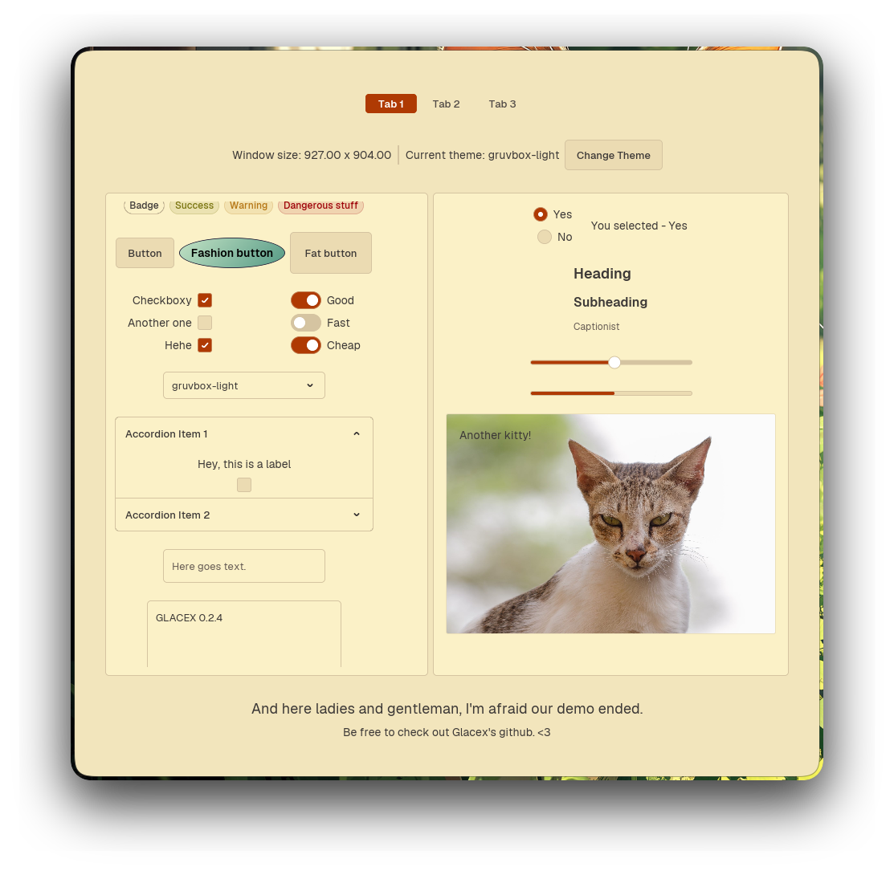

<div align="center">



# glacex

<p align="center">
  <a href="https://crates.io/crates/glacex"></a>
  <a href="https://docs.rs/glacex"></a>
  <a href="https://github.com/artemtsitronov/glacex/blob/main/LICENSE"></a>
  
  
  <a href="https://github.com/artemtsitronov/glacex/stargazers"></a>
</p>

An immediate mode UI library for Rust that runs on the GPU. Written from scratch on top of `wgpu`, `winit` and `taffy`.

Developed by **Artem Tsitronov**(author) and Glacex **contributors**(thank you so much <3).
If you have any questions or problems, just email me at <artemtsitronov@gmail.com>

</div>

> **Status**: 0.2.0 is a lot more stable than before and I'm not planning any big API changes.
If something big does change, I'll let you know first.

## Table of Contents

- [What is glacex?](#what-is-glacex)
- [Features](#features)
- [Requirements](#requirements)
- [Installation](#installation)
- [Quick Start](#quick-start)
- [Core Concepts](#core-concepts)
  - [App](#app)
  - [Widget & Measurable](#widget-and-measurable)
  - [Ui Context](#ui)
  - [Layout](#layout)
- [Widgets](#widgets)
  - [Controls](#controls)
  - [Containers](#containers)
  - [Displays](#displays)
- [Styling & Theming](#styling)
  - [Style Structs](#style-structs)
  - [ShadowStyle](#shadowstyle)
  - [Color Type](#color)
  - [Fills, Gradients & Images](#fills-gradients--images)
  - [Custom Shapes / Paths](#custom-shapes--paths)
  - [Theme Palette](#theme)
  - [Window Control](#window-title-and-background)
- [Accessibility](#accessibility)
- [How Rendering Works](#how-rendering-works)
- [Examples](#examples)
- [Project Layout](#project-layout)
- [Known Limitations](#known-limitations)
- [Documentation](#documentation)
- [Contributing](#contributing)
- [License](#license)

If you want a more experimental version of glacex, there's the programmersd21 fork at https://github.com/programmersd21/glacex

Just so you know, I'm not responsible for that fork. That includes big changes, redesigns and AI generated stuff in it.

## What is glacex?

`glacex` is an immediate mode UI library for Rust. It doesn't wrap a native toolkit or a browser engine. It draws everything itself.

Here's what it uses under the hood:

- **`winit`** handles the window and the event loop on every platform.
- **`wgpu`** draws every shape on the GPU as an instanced SDF quad.
- **`glyphon`** shapes the text and puts the glyphs into atlases, and each widget gets its own clipping.
- **`taffy`** does the flexbox math for `row!` and `column!`.
- **`image`** decodes images.
- **`kurbo`** handles paths.

There's no retained widget tree and no markup. You just write your UI in normal Rust every frame, and glacex measures it, lays it out, handles input, animates it and renders it.

## Features

- Its own renderer. Shapes are anti aliased SDFs with borders and soft shadows, and everything with the same clip rect goes into one draw call.
- Custom Bezier shapes with `MeasurablePath::Free`, drawn by a second mesh pipeline. So you're not stuck with rects and ellipses. More in [Custom Shapes / Paths](#custom-shapes--paths).
- Text with `glyphon`, and every widget clips its own text.
- Solid colors, gradients (linear, radial and conic) and images as fills. They get cached in a GPU atlas.
- `Color` is `#[repr(C)]` and `Pod`/`Zeroable`, so it goes straight into vertex buffers. You can make colors from hex, RGB or HSV, and blend, lerp, lighten or darken them.
- The cursor changes on hover (pointer, text, resize or default).
- Tooltips that float above everything and stay inside the window.
- Widgets: `Button`, `Checkbox`, `RadioButton`, `Switch`, `Slider`, `ProgressBar`, `TextInput`, `TextArea`, `ScrollView`, `Card`, `Container`, `Badge`, `Divider`, `Label`, `SelectBox`, `Tabs`, `Accordion`.
- `row![]` and `column![]` macros that use `taffy`, with alignment and spacing.
- Input stuff like hover, press and click, right and middle mouse buttons, Tab and Shift+Tab focus, double click to select a word and triple click for a line, clipboard through `arboard` and a blinking cursor.
- Widgets get rebuilt every frame, but their state sticks around because it's saved under a string id. Every stateful widget has `.state(ui)`, `.take_state(ui)` and `.put_state(ui, state)` from the `StatefulWidget` trait. Most of them also have simple helpers like `checkbox.is_checked(ui)` or `slider.value(ui)`. Check out [Widgets](#widgets) for more. Underneath all that are `Ui::widget_state`, `take_widget_state` and `put_widget_state`, which you can use for state that doesn't belong to one widget.
- Animations use exponential decay (`animate_towards`), plus a few easing curves and spring presets. There are named half life constants (`Motion::INSTANT`, `SNAPPY`, `FLUID` and `GENTLE`) so every widget animates with the same kind of feel.
- Scrollbars you can drag that hide when you don't need them. `ScrollView` and `TextArea` both use them.
- Accessibility support you can turn on (AT-SPI on Linux through `accesskit`). See [Accessibility](#accessibility).

## Requirements

- Rust 1.88 or newer (2024 edition)
- A GPU and driver that `wgpu` supports, so Vulkan, Metal, DirectX 12 or OpenGL ES
- On Linux you need a Wayland or X11 session running. If you're headless you'll need a virtual display like `xvfb` to get a window surface

## Installation

### From crates.io

```bash
cargo add glacex
```

Or put it in your `Cargo.toml`

```toml
[dependencies]
glacex = "0.2.3"
```

### From GitHub (main branch)

```toml
[dependencies]
glacex = { git = "https://github.com/artemtsitronov/glacex.git", branch = "main" }
```

### Linux build dependencies

```bash
# Debian / Ubuntu
sudo apt install libx11-dev libxcursor-dev libxrandr-dev libxi-dev libxkbcommon-dev libwayland-dev

# Fedora
sudo dnf install libX11-devel libXcursor-devel libXrandr-devel libXi-devel libxkbcommon-devel wayland-devel

# Arch Linux
sudo pacman -S libx11 libxcursor libxrandr libxi libxkbcommon wayland
```

## Quick Start

Here's a tiny counter app

```rust
use glacex::{App, Button, Color, Label, Ui, Widget, column};

struct Counter {
    count: u32,
}

impl Widget for Counter {
    type Output = ();

    fn ui(&mut self, ui: &mut Ui) {
        ui.set_bgcolor(Color::rgb(18, 18, 22));

        let mut label = Label::new(format!("Count: {}", self.count));
        let mut button = Button::new("Increment").id("increment-button");

        column![&mut label, &mut button]
            .spacing(12.0)
            .arrange_at([40.0, 40.0], ui);

        if button.clicked() {
            self.count += 1;
        }
    }
}

fn main() {
    App::new(Counter { count: 0 }).run();
}
```

`App::new(root).run()` opens the window, sets up the GPU and starts the event loop.

## Core Concepts

### App

`App<W: Widget>` owns the `winit` window and the event loop

```rust
App::new(root_widget)
    .update(|root| {
        // Runs once per frame before rendering. Good place for
        // app-level state changes based on the previous frame's input.
    })
    .run();
```

### Widget and Measurable

Everything in the UI implements `Widget`

```rust
pub trait Widget {
    type Output;
    fn ui(&mut self, ui: &mut Ui) -> Self::Output;
}
```

If a widget can go inside `row!` or `column!` it also implements `Measurable`

```rust
pub trait Measurable: Widget {
    fn measure(&mut self, ui: &mut Ui) -> [f32; 2];
    fn arrange(&mut self, position: [f32; 2], size: [f32; 2], ui: &mut Ui) -> Self::Output;
}
```

`measure` tells the layout how big the widget wants to be. `arrange` gets the final rect, then handles input and hit testing and does the drawing.

### Ui

`Ui` is the context every widget gets each frame. Here's roughly what's on it

- Input with `mouse_position()`, `mouse_pressed()`, `mouse_right_pressed()`, `click_count()`, `key_pressed()`, `ctrl_held()` and `shift_held()`
- Cursor with `set_cursor_icon(CursorIcon)`
- Tooltips with `show_tooltip(text)` and `show_tooltip_at(text, pos)`
- State with `widget_state::<T>(id)`, `take_widget_state::<T>(id)` and `put_widget_state(id, state)`. These are what every widget's `.state(ui)`, `.take_state(ui)` and `.put_state(ui, state)` use
- Focus with `request_focus(id)`, `is_focused(id)` and `advance_focus(backward)`
- Clipping with `push_clip(rect)`, `pop_clip()` and `push_input_block(rect)`
- Drawing with `draw_shape(...)`, `draw_text(...)`, `measure_text(...)` and `line_height()`
- The window with `set_title(&str)` and `set_bgcolor(Color)`

### Layout

Layout has its own page, go check out `docs/layout.md`.

## Widgets

### Controls

#### Button
```rust
let mut btn = Button::new("Deploy")
    .id("button")
    .tooltip("Triggers a deployment event")
    .primary();

if btn.clicked() {
    println!("clicked");
}
```
There's also `.primary()`, `.outline()`, `.ghost()` and `.danger()`.

#### Checkbox
```rust
let mut check = Checkbox::new().id("checkbox").default_checked(true);
let is_checked = check.is_checked(ui);
```

#### RadioButton
```rust
row![
    &mut RadioButton::new("theme_group").id("dark"),
    &mut Label::new("Dark Theme"),
];

let selected = ui.selected_option("theme_group").unwrap_or("dark");
```

#### Switch
```rust
let mut sw = Switch::new().id("switch").default_enabled(true);
let enabled = sw.enabled(ui);
```

#### Slider
```rust
let mut slider = Slider::new(0.0, 100.0).id("slider").width(240.0).default_value(50.0);
let val = slider.value(ui);
```

#### TextInput
```rust
let mut input = TextInput::new().id("username-input").width(260.0).placeholder("Enter a username");
let text = input.text(ui);
```

#### TextArea
```rust
let mut notes = TextArea::new().id("notes").size([300.0, 120.0]);
```

#### SelectBox
```rust
use glacex::{SelectBox, SelectOption};

let options = vec![
    SelectOption::new("light", "Light"),
    SelectOption::new("dark", "Dark"),
    SelectOption::new("mocha", "Catppuccin Mocha"),
    SelectOption::new("tokyo", "Tokyo Night"),
];

let mut sel = SelectBox::new(options)
    .id("select-box")
    .placeholder("Choose a theme…")
    .width(220.0)
    .tooltip("Switch the active colour theme");

sel.arrange_at([40.0, 40.0], ui);

let selected = sel.selected(ui);
```

If you want to search through the options, add `.searchable()`

```rust
let mut sel = SelectBox::new(countries)
    .id("searchable")
    .placeholder("Select a country…")
    .width(260.0)
    .searchable();
```

The dropdown opens with a spring animation and closes when you press Escape or click somewhere else. You can move through it with the arrow keys and pick something with Enter.

#### Tabs
```rust
use glacex::{Tabs, TabItem};

let mut tabs = Tabs::new(
    vec![
        TabItem::new("General").id("tab1"),
        TabItem::new("Account").id("tab2"),
        TabItem::new("Billing").id("tab3"),
    ],
).id("tabs");

let selected = tabs.selected(ui);
```

The pill behind the active tab slides over and resizes with a spring when you click a different tab. The selection updates right away. It's stored the same way as `RadioButton` groups, so `ui.selected_option("tabs")` works too.

### Containers

#### Card
```rust
let mut content = Label::new("Inside Card");
let mut card = Card::new(&mut content).padding([16.0, 16.0]);
```

#### ScrollView
```rust
ScrollView::new(&mut child_column)
    .id("scroll-view")
    .size([300.0, 150.0])
    .arrange_at([20.0, 20.0], ui);
```

#### Accordion
- `Accordion::new(vec![AccordionItem::new("Title", &mut content)])` stacks sections you can open and close. Add `.multiple()` if more than one can be open at once

#### Container & Divider
- `Container::new(&mut child).size([w, h])` wraps a child in a box with a fixed size
- `Divider::horizontal(width)` and `Divider::vertical(height)` draw a separator line. Add `.faint()` if you want it lighter

### Displays

- `Label::new(text)` is just text. It has `.secondary()`, `.muted()` and `.accent()`, some size presets like `.caption()`, `.heading()` and `.metric()`, and `.mono()`
- `Badge::new(text)` is a little status pill with `.secondary()`, `.outline()`, `.success()`, `.warning()` and `.error()`
- `ProgressBar::new(ratio)` is a progress bar

## Styling

### Style Structs

Every widget has its own `*Style` struct, and it controls everything the widget draws. That means fills, borders, shadows, padding, fonts, shapes, animation timings and the hover cursor. The easy way is to start from a theme preset and only change the fields you care about with `..`

```rust
use glacex::{Border, Button, ButtonStyle, Color, CursorIcon, Fill, Path, ShadowStyle, Stateful};

let save_btn = Button::new("Save").id("btn").style(ButtonStyle {
    fill: Stateful::new(Color::hex_str("#4f46e5"))
        .hovered(Color::hex_str("#6366f1"))
        .pressed(Color::hex_str("#4338ca"))
        .into(),
    border: Border::new(1.0, Color::WHITE.with_alpha(0.2)).into(),
    path: Path::rect([8.0; 4]).into(),
    shadow: ShadowStyle::new(Color::hex_str("#4f46e5").with_alpha(0.4), 12.0, [0.0, 3.0]).into(),
    scale: Stateful::new(1.0).hovered(1.03).pressed(0.97),
    cursor: CursorIcon::Pointer,
    ..ButtonStyle::primary(ui.theme())
});
```

### Per-state values: `Stateful<T>`

If a property can change when you interact with the widget, it's a `Stateful<T>`. It has an `idle` value, and you can also give it `hovered`, `pressed`, `focused`, `selected` and `selected_hovered` values. Any state you don't set just uses the one below it. A plain value turns into a `Stateful` that looks the same in every state, so simple stuff stays simple

```rust
Button::new("Save").fill(Color::rgb(200, 40, 40))

Button::new("Save").fill(
    Stateful::new(Color::rgb(200, 40, 40)).hovered(Color::rgb(230, 60, 60))
)
```

`Button`, `Card`, `Checkbox`, `RadioButton`, `Switch`, `Slider`, `TextInput`, `TextArea`, `SelectBox`, `Badge` and `ProgressBar` also have `.fill(..)`, `.border(..)` and `.shadow(..)` builders. You can pass them a plain value or a `Stateful`. `Label` has `.fill(..)`, `.text_color(..)`, `.border(..)` and `.padding(..)`. And `.color(..)` and `.thickness(..)` on `Divider` take a `Stateful` too.

The states always stack in the same order. First `idle`, then `hovered`, then `selected` (or `selected_hovered` if it's hovered), then `focused` and then `pressed`. Every layer fades in with its own animation. What `selected` means depends on the widget. It's checked for `Checkbox`, on for `Switch`, the picked option for `RadioButton`, the active tab in `Tabs` and the picked item in `SelectBox`. `pressed` is also used while you drag a slider or a scrollbar thumb.

How things blend depends on the type. Numbers, colors, solid fills, shadows and text size and color all blend smoothly. Gradients, images, paths, font weight and font family just flip over halfway through. When a color blends from fully transparent it keeps the hue of the target, so it doesn't fade through black. You can put any type that implements `Blend` in a `Stateful`.

A few things that work the same in every style

- **States**. Fields with a † in the table below are `Stateful<T>`. Almost everything is. The exceptions are animation timings (`*_motion` and spring stiffness and damping), on and off flags like `sharp` or `clip_content`, enums, alignment, strings, `syntax`, `scroll_speed` and `cursor_blink_period`. `Badge`, `Label`, `Divider` and `ProgressBar` only have the `hovered` state. Sizes like padding and heights get measured with last frame's state, so the layout is one frame behind.
- **Sub parts**. The select box dropdown and its search bar react when you hover the dropdown. Its items and each tab react to their own hover and to being selected. The tabs indicator reacts when you hover the active tab. Scrollbar tracks and thumbs react to their own hover and to dragging.
- **Shape**. `path` can be any `Path`, so `Path::rect(radii)`, `Path::ellipse(rot)` or `Path::from_fn(..)`. `sharp` turns off anti aliasing.
- **Text**. `text_style` sets the font family, size, line height, weight and color. If you call `.text_style(..)` on the widget it still wins. If that one has no color, it uses the color from the style.
- **Animation**. Every `*_motion` field is a half life in seconds. You can use `Motion::INSTANT`, `SNAPPY`, `FLUID`, `GENTLE` or any `f32` you want. `0.0` means no animation at all.
- **Cursor**. `cursor` is the cursor you get on hover (`glacex::CursorIcon`).

| Style Struct | Target Widget | Fields |
|---|---|---|
| `ButtonStyle` | `Button` | `fill`†, `border`†, `padding`†, `min_size`†, `text_style`†, `text_align`, `shadow`†, `sharp`, `path`†, `scale`†, `offset`†, `hover_motion`, `press_motion`, `cursor`† |
| `BadgeStyle` | `Badge` | `fill`†, `border`†, `padding`†, `height`†, `min_width`†, `text_style`†, `text_align`, `shadow`†, `sharp`, `path`†, `hover_motion` |
| `CardStyle` | `Card` | `fill`†, `border`†, `padding`†, `min_size`†, `shadow`†, `sharp`, `clip_content`, `path`†, `hover_motion`, `cursor`† |
| `CheckboxStyle` | `Checkbox` | `fill`†, `check_color`†, `check_thickness`†, `check_scale`†, `border`†, `shadow`†, `sharp`, `path`†, `size`†, `pop_scale`†, `check_motion`, `hover_motion`, `pop_motion`, `cursor`† |
| `RadioButtonStyle` | `RadioButton` | `fill`†, `border`†, `shadow`†, `sharp`, `dot_color`†, `dot_inset`†, `dot_path`†, `path`†, `size`†, `dot_motion`, `hover_motion`, `cursor`† |
| `SwitchStyle` | `Switch` | `track_fill`†, `thumb_fill`†, `thumb_border`†, `thumb_padding`†, `thumb_size`†, `thumb_shadow`†, `thumb_path`†, `trail_color`†, `trail_stretch`†, `trail_max`†, `border`†, `shadow`†, `sharp`, `path`†, `size`†, `toggle_motion`, `hover_motion`, `cursor`† |
| `SliderStyle` | `Slider` | `track_fill`†, `filled_fill`†, `thumb_fill`†, `thumb_border`†, `border`†, `track_height`†, `thumb_size`†, `vertical_padding`†, `shadow`†, `trail_color`†, `trail_stretch`†, `trail_max`†, `sharp`, `path`†, `filled_path`†, `thumb_path`†, `hover_motion`, `drag_motion`, `velocity_motion`, `cursor`† |
| `ProgressBarStyle` | `ProgressBar` | `track_fill`†, `progress_fill`†, `border`†, `progress_border`†, `progress_inset`†, `min_progress_width`†, `size`†, `shadow`†, `sharp`, `path`†, `progress_path`†, `progress_motion`, `hover_motion` |
| `TextInputStyle` | `TextInput` | `fill`†, `text_style`†, `placeholder_color`†, `border`†, `padding`†, `selection_color`†, `selection_radius`†, `cursor_color`†, `cursor_width`†, `cursor_blink_period`, `shadow`†, `sharp`, `path`†, `hover_motion`, `focus_motion`, `cursor`† |
| `TextAreaStyle` | `TextArea` | `fill`†, `text_style`†, `syntax`, `border`†, `padding`†, `selection_color`†, `selection_radius`†, `current_line_fill`†, `cursor_color`†, `cursor_width`†, `cursor_blink_period`, `thumb_fill`†, `thumb_path`†, `scrollbar`†, `scroll_speed`, `shadow`†, `sharp`, `path`†, `hover_motion`, `focus_motion`, `cursor`† |
| `ScrollViewStyle` | `ScrollView` | `fill`†, `border`†, `background_path`†, `track_fill`†, `thumb_fill`†, `scrollbar`†, `always_show_scrollbars`, `scroll_speed`, `clip_content`, `sharp`, `path`†, `track_path`†, `hover_motion`, `cursor`† |
| `SelectBoxStyle` | `SelectBox` | `fill`†, `text_style`†, `placeholder_color`†, `border`†, `shadow`†, `height`†, `padding_x`†, `show_chevron`, `chevron_color`†, `chevron_size`†, `chevron_thickness`†, `chevron_open_angle`†, `chevron_space`†, `dropdown_fill`†, `dropdown_border`†, `dropdown_padding`†, `dropdown_max_height`†, `dropdown_screen_margin`†, `dropdown_shadow`†, `item_height`†, `item_inset_x`†, `item_padding_x`†, `item_fill`†, `item_text_style`†, `item_corner_radius`†, `show_check`, `check_color`†, `check_thickness`†, `searchable`, `search_height`†, `search_gap`†, `search_padding_x`†, `search_fill`†, `search_border`†, `search_corner_radius`†, `search_text_style`†, `search_placeholder`, `sharp`, `path`†, `hover_motion`, `focus_motion`, `chevron_motion`, `item_hover_motion`, `open_stiffness`, `open_damping`, `cursor`† |
| `TabsStyle` | `Tabs` | `height`†, `tab_padding_x`†, `tab_min_width`†, `gap`†, `padding_x`†, `fill`†, `border`†, `shadow`†, `text_style`†, `tab_fill`†, `indicator_fill`†, `indicator`, `indicator_border`†, `indicator_shadow`†, `pill_inset_y`†, `sharp`, `path`†, `indicator_path`†, `tab_path`†, `hover_motion`, `indicator_motion`, `cursor`† |
| `DividerStyle` | `Divider` | `fill`†, `thickness`†, `margin`†, `inset`†, `sharp`, `path`†, `hover_motion` |
| `AccordionStyle` | `Accordion` | `header_height`, `header_padding_x`, `header_fill`†, `header_border`†, `header_path`†, `header_text_style`†, `chevron`, `content_padding`, `show_dividers`, `divider_color`, `sharp`, `hover_motion`, `focus_motion`, `open_stiffness`, `open_damping`, `cursor`† |
| `LabelStyle` | `Label` | `padding`†, `align_x`, `align_y`, `fill`†, `text_color`†, `border`†, `sharp`, `path`†, `hover_motion` |

Presets you can start from are `ButtonStyle::{from_theme, primary, outline, ghost, danger}`, `BadgeStyle::{.., tinted(theme, color)}`, `CardStyle::{.., interactive}`, `CheckboxStyle::circle`, `RadioButtonStyle::outlined`, `SwitchStyle::square`, `SliderStyle::thick`, `ProgressBarStyle::colored(theme, color)`, `TextInputStyle::filled`, `TextAreaStyle::code`, `ScrollViewStyle::panel`, `SelectBoxStyle::filled`, `TabsStyle::{segmented, underline}`, `AccordionStyle::filled`, `DividerStyle::{faint, strong, rounded}` and `LabelStyle::highlighted`.

### ShadowStyle

```rust
pub struct ShadowStyle {
    pub color: Color,
    pub blur_radius: f32,
    pub offset: [f32; 2],
    pub spread: f32,
}

let shadow = ShadowStyle::new(Color::BLACK.with_alpha(0.3), 12.0, [0.0, 4.0]).spread(2.0);
```

### Color

`Color` is `#[repr(C)]` and derives `bytemuck::Pod` and `Zeroable`, so you can put it right into a GPU vertex buffer

```rust
Color::rgb(255, 128, 0);
Color::rgba(255, 128, 0, 0.5);
Color::hex_str("#4f46e5");
Color::hex(0x4f46e5);
Color::hsv(240.0, 0.8, 0.9);

let tinted = Color::WHITE.with_alpha(0.3);
let blended = Color::RED.lerp(Color::BLUE, 0.5);
let dark = Color::RED.darken(0.2);
let light = Color::RED.lighten(0.2);
```

### Fills, Gradients & Images

```rust
use glacex::{Color, Fill, Gradient, GradientKind, GradientStop};

let sunset = Fill::Gradient(Gradient {
    kind: GradientKind::Linear { angle: 90.0 },
    stops: vec![
        GradientStop { position: 0.0, color: Color::hex_str("#ff7e5f") },
        GradientStop { position: 1.0, color: Color::hex_str("#feb47b") },
    ],
});
```

You've got `GradientKind::Linear { angle }`, `Radial { center, radius }` and `Conic { center }`. Gradients get cached in a GPU atlas by their content, so using the same one every frame costs basically nothing.

Images work just like colors and gradients. Load it once and then use it anywhere you'd use a `Fill`

```rust
let logo = ui.load_image("assets/logo.png"); // PNG/JPEG/WebP via the `image` crate
let fill = Fill::Image(logo);
```

`ImageHandle::width()`, `height()` and `size()` give you the image size in pixels. That's handy if you want a widget to be the same size as the image.

### Custom Shapes / Paths

All the built in widgets draw either a rounded rect or an ellipse (`MeasurablePath::Rect` or `Ellipse`). But the renderer can also draw any shape you want with `MeasurablePath::Free(BezPath)`. The outline is a `BezPath` from [`kurbo`](https://docs.rs/kurbo)

```rust
use glacex::{Color, Fill, MeasurablePath};
use kurbo::BezPath;

let mut star = BezPath::new();
star.move_to((160.0, 90.0));
star.line_to((188.0, 152.0));
// ...remaining points...
star.close_path();

ui.draw_shape(
    MeasurablePath::free(star),
    Fill::Solid(Color::hex_str("#f59e0b")),
    Border::new(4.0, Color::hex_str("#1e293b")),
    0.0,                          // blur_radius, not supported for Free paths, ignored
    false,                        // sharp
    0.0,                          // rotation, radians
);
```

Free paths get turned into triangles on the CPU and drawn with their own pipeline, not the SDF one that rects and ellipses use.

Solid and gradient fills both work. The gradient color is worked out per vertex, so `Linear` looks exactly right and `Radial` and `Conic` are pretty close. Curvier shapes have more vertices so they look even better. `Fill::Image` doesn't work on free paths yet and just shows up transparent, same as `GradientKind::Mesh`.

Borders are drawn as a separate outline around the shape with `kurbo::stroke`. So it looks like an SVG stroke, not like the inset border that rect and ellipse widgets have.

Free paths get batched and clipped like everything else. Right now though they always draw after all the rects and ellipses in the frame, mixing the draw order isn't done yet. Also only simple shapes work properly. If your path crosses itself or has holes, only the outer edge gets filled right.

### Theme

There are 9 built in themes and you can switch between them at runtime with `ui.set_theme(...)`

```rust
ui.set_theme(Theme::LIGHT);
ui.set_theme(Theme::DARK);
ui.set_theme(Theme::CATPPUCCIN_MOCHA);
ui.set_theme(Theme::CATPPUCCIN_LATTE);
ui.set_theme(Theme::TOKYO_NIGHT);
ui.set_theme(Theme::GRUVBOX_DARK);
ui.set_theme(Theme::GRUVBOX_LIGHT);
ui.set_theme(Theme::NORD);
ui.set_theme(Theme::ROSE_PINE);
```

#### Design tokens

| Token | Default (`LIGHT`) | Used for |
|---|---|---|
| `bg_canvas` | `#ffffff` | Window background |
| `surface` | `#ffffff` | Cards, panels |
| `surface_subtle` | `#f4f4f5` | Inset panels, control tracks |
| `surface_elevated`| `#ffffff` | Modals, tooltips, dropdowns |
| `idle` | `#f4f4f5` | Resting button/control fill |
| `hovered` | `#e4e4e7` | Hover state |
| `pressed` | `#d4d4d8` | Pressed state |
| `active` | `#18181b` | Primary action |
| `border_faint` | `rgba(0,0,0,0.04)` | Hairline dividers |
| `border` | `rgba(0,0,0,0.08)` | Standard borders |
| `border_strong` | `rgba(0,0,0,0.16)` | Focused/emphasized borders |
| `text_primary` | `#09090b` | Body text |
| `text_secondary`| `#71717a` | Captions |
| `text_muted` | `#a1a1aa` | Placeholders, metadata |
| `success` | `#16a34a` | Success state |
| `warning` | `#d97706` | Warning state |
| `error` | `#e11d48` | Error state |

### Window Title and Background

```rust
ui.set_title("My App");
ui.set_theme(Theme::LIGHT); // also updates the window background color
```

## Accessibility

glacex can show its widgets to screen readers and other assistive tech through [`accesskit`](https://accesskit.dev/). That's AT-SPI on Linux, UIA on Windows and NSAccessibility on macOS. It's off by default, so you have to turn it on when you make the app

```rust
App::new(root_widget)
    .accessibility_enabled(true)
    .run();
```

Widgets like `Button`, `Checkbox` and `TextInput` get a role and a label on their own. I've tested it with Orca and Accerciser on Arch Linux.

## Examples

```bash
# Dashboard-style demo (buttons, inputs, switches, sliders, logs)
cargo run --example demo

# Color/theme preview
cargo run --example example1

# Style playground
cargo run --example example2

# Simple demo application
cargo run --example reminder

# Demonstation of free shapes
cargo run --example free_shape

# Theming demonstration
cargo run --example themes
```

## Known Limitations

- `GradientKind::Mesh` is there but doesn't do anything yet. It just draws transparent, so use Linear, Radial or Conic for now.
- `MeasurablePath::Free` doesn't support `Fill::Image`, blur, shadows, holes or paths that cross themselves. It also always draws after rects and ellipses in the same clip rect. More about it in [Custom Shapes / Paths](#custom-shapes--paths).

## Documentation

- [Architecture & Rendering](docs/architecture.md) is about `wgpu`, the SDF shaders and how a frame works
- [Widget Reference](docs/widgets.md) has every widget with its constructor and builder methods
- [Layout Guide](docs/layout.md) explains how flexbox works with `taffy`

## Contributing

Bug reports and PRs are always welcome. Have a look at [CONTRIBUTING.md](CONTRIBUTING.md) for the code style and what to check before opening a PR.

## License

MIT. See [LICENSE](LICENSE).

Copyright (c) 2026 Artem Tsitronov and Glacex contibutors.

## If you scrolled far enough to see this

Thank you! Please star the project or grab it from crates.io.
Either way it really makes my day!
I'd love to hear any feedback from you, criticism too.
Any help means a lot.

- Artem Tsitronov
